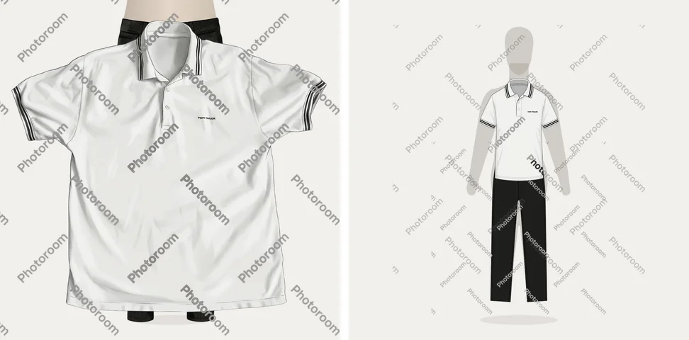

# Проверка посадки по шаблонам — 30 октября 2026

В рамках #94 пользователь разрешил две новые генерации Gemini на ранее
использованных публичных фото: light-polo и black-jeans. Выполнены ровно две,
с финальной сегментацией Photoroom sandbox. Прежние исходные вырезки и признаки
переиспользованы. Пользовательские вещи и сохранённые публикации не менялись.

## Что получилось

Это локальная композиция настоящих PNG на координатах манекена приложения,
не снимок экрана iPhone. Слева — сохранённые реальные результаты v1;
справа — две новые генерации после равномерного масштаба и переноса.
Водяные знаки sandbox сохранены. Поло занимает торс, брюки начинаются у талии,
две прямые раздельные штанины доходят до щиколоток. Проверка не доказывает
сохранность каждой детали исходника или качество остальных типов одежды.

Шаблон сам по себе не обеспечил масштаб. Сырые результаты обоих новых вызовов
отклонены геометрической проверкой. Затем эти же сохранённые PNG обработаны
локально функцией `registerGarmentLayout`, без дополнительных внешних вызовов.

| Фото | Доля непрозрачных пикселей вне области до размещения | После | Проверка после |
| --- | ---: | ---: | --- |
| light-polo | 5.83% | 0% | пройдена |
| black-jeans | 69.02% | 0% | пройдена, включая раздельные штанины и длину от талии до щиколоток |

Генерации выполнены в 14:46:34–14:46:57 и 14:50:08–14:50:28 UTC.
Проверка после размещения использует реализацию из `370dc56`.
Это проверка реального вывода модели плюс локальной финализации;
новая версия приложения на сервер не выкладывалась.

## Воспроизводимость и расходы

SHA-256 входных публичных PNG:

- light-polo: `39f8c6dd13a72137c4d8c174103ef49f0835f1dd02c0327b195ce7a5ff4200c7`.
- black-jeans: `8c6001c201cb16e336da9c702eff1a6c8bc139c2352c2cd82953c523e66ad63b`.

В существующем долговечном журнале добавлены две резервации Gemini по $0.40
и две нулевые резервации Photoroom sandbox. Общий серверный резерв после пробы
$4.855060: Gemini 12 вызовов, Jev 20, Photoroom 32. С ранее учтённым внешним
резервом $1.20 общий резерв $6.055060, ниже согласованных $10. Это консервативный
резерв, не счёт провайдеров. Журнал и лимиты не сбрасывались. Маркеры однократного
запуска предотвращают повтор этих двух генераций.

Исходные и итоговые артефакты текущей сессии:
`/tmp/saint-look-anchor-trial-20261030/`; технические отчёты
`budget-and-reports.json` и `registration-report.json`. Путь временный;
сравнение выше сохранено в репозитории как постоянное визуальное свидетельство.

## Автоматические проверки и ограничения

`cd backend && node --test test/illustration-layout.test.mjs` проверяет:
отказ полного слитого силуэта, неизменность корректного слоя, равномерное
размещение независимой двухштанинной фигуры, отказ слитых штанин, сохранение
всех видимых пикселей sandbox и отказ ошибочно укороченных широких брюк.

В iOS добавлены сценарии автоматического показа первой полной публикации,
возобновления после недоступности провайдера, сохранения ракурса и перезапуска,
а также изменения ракурса во время активной генерации. Нативные результаты
фиксируются CI соответствующего коммита PR #95.

Семейства шаблонов покрывают текущую таксономию, но визуально проверены только
эти две вещи. Геометрия не распознаёт материал, принты и все ошибки конструкции.
Неподходящий результат завершает подготовку ошибкой без автоматической платной
перегенерации. Старые v1 остаются видимыми в карточках; для наложения на общий
манекен требуется явное обновление посадки, без массовой платной миграции.
